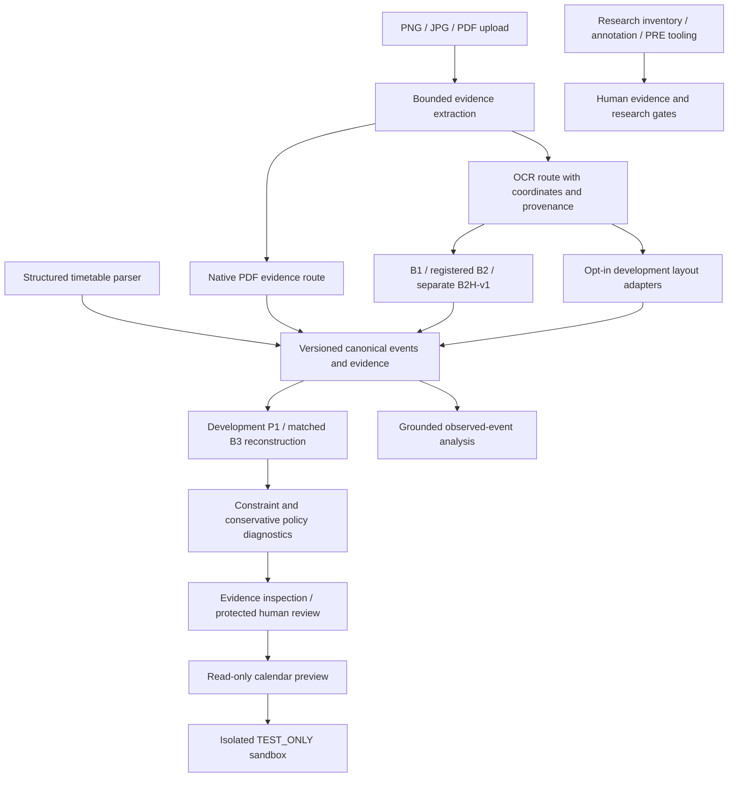

# Architecture and implemented boundaries

This describes the complete application integrated on `feature/complete-v1-handover`. Two historical S4B host/test files stay excluded in favor of portable synthetic tests and the separate frontend transport check. [Release review](publication-checklist.md).

The arrow into TEST_ONLY represents a capability that requires separately trusted source/target enrollment and exact explicit owner approval. Normal website startup remains unenrolled; the diagram grants no authority. There is no automatic write to an external calendar. The structured-source parser is separate from OCR baselines and does not certify live portal compatibility.

The FastAPI entry point is `backend.main:app`; router packages cover reconstruction, review, calendar, layout and analysis. Pydantic event/evidence models separate extraction, rule validity, selective policy, human verification, schedule completeness, approval and observed external state. Original source/provenance and unresolved values are preserved rather than invented.

The static frontend consists of `frontend/index.html`, `styles.css` and seven JavaScript controllers loaded by that HTML. It calls the documented loopback API; serve only the frontend folder. There is no frontend framework rewrite or database migration.

Native PDF text and registered shared OCR remain different evidence modes. Development layout profiles do not alter registered research definitions. B2H-v1 stays a named compatibility variant; its results are not original B2 research performance.

Review state is process-local. TEST_ONLY calendar storage uses isolated hash-linked local journal records, exact approval/source/snapshot binding and reconciliation of uncertain outcomes. This is not a production identity/TLS service, full application activity archive, encryption or independent research attestation.

`portable-s4b-v1` is a separate invented test specification, deterministic PDF generator, hash-pinned resource manifest and TestClient-only factory. It creates fresh scoped capabilities for isolated tests, has no server entry point and reads no historical approval or journal. The immutable old S4B tests/host and their records are separate. No portable success retroactively authorizes a live demo or proves a research result.

Research tooling does not supply human verification. Independent roles, source permission, annotation/adjudication, audit, Gold freeze, seal and PRE gates still govern evaluation. The software diagrams and tests do not establish RO1–RO4/RQ1–RQ4 achievement.
