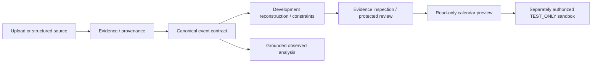

# Project architecture — local system versus public starter

The local implementation uses a FastAPI/Pydantic backend and static HTML/CSS/JavaScript frontend. This summary is for collaboration; **none of those application modules is included in this starter**.

Native PDF evidence and shared OCR are distinct. Registered B2 and named B2H-v1 remain separate. Extraction/ACCEPT/rule validity do not imply source correctness, human verification, complete-schedule assurance or calendar approval. Normal startup grants no privileged reviewer or calendar writer, and no arrow authorizes a real calendar write.

The public starter contains only documentation/templates plus `starter_tools` and its synthetic tests. Those utilities check Markdown file links; they implement no research baseline, OCR, event reconstruction, source permission decision or PRE gate. Future approved modules must arrive with their complete dependency and test contracts.
